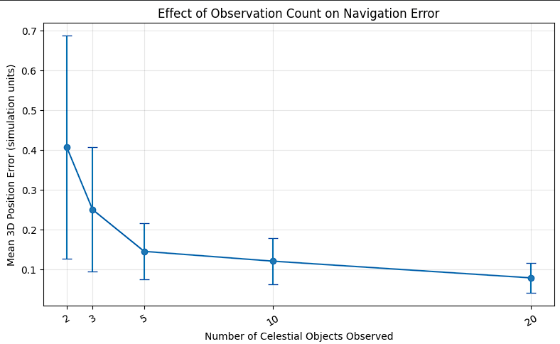
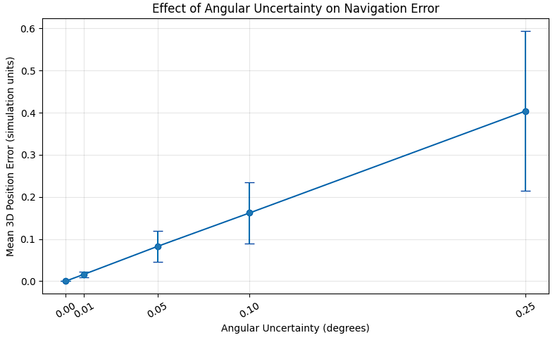

# Autonomous-Spacecraft-Navigation

A Python-based simulation investigating autonomous spacecraft position estimation through celestial observations and nonlinear least-squares optimization.

## Research Objective

This project examines how the number of observed celestial objects and angular measurement uncertainty affect the accuracy of spacecraft position estimation.

## Methodology

The simulation uses:
- Three-dimensional directional vectors to represent celestial observations.
- Simulated angular measurement uncertainty.
- Nonlinear least-squares optimization using SciPy.
- 100 trials per experimental condition to evaluate positioning accuracy and consistency.

## Experimental Investigations

**Experiment 1: Number of Observations**

Examines how increasing the number of observed celestial objects from 2 to 20 affects positioning accuracy while maintaining 0.05° angular uncertainty.

**Experiment 2: Angular Measurement Uncertainty**

Examines how increasing angular uncertainty from 0.00° to 0.25° affects positioning accuracy while maintaining 20 observations.

## Key Findings

- Increasing observations from 2 to 20 reduced mean positioning error from 0.406605 to 0.078638 simulation units.
- Increasing angular uncertainty from 0.00° to 0.25° increased mean positioning error from 0.000000 to 0.404013 simulation units.
- Jacobian and singular-value analysis was used to investigate the mathematical conditioning of the estimation problem.

## Technologies

- Python
- NumPy
- SciPy
- Matplotlib

## Limitations

This project uses synthetically generated celestial objects and controlled simulated measurement uncertainty. It does not represent a complete or operationally validated spacecraft navigation system.

## Repository Contents

- `src/` — Python simulation source code.
- `research/` — Complete research paper.
- `results/` — Experimental graphs and numerical results.

## Future Research

Future work may investigate geometry-aware observation selection and the use of actual astronomical data to improve the realism of the simulation.

## Research Paper

See the `research/` directory for the complete research paper.
## Running the Simulation

### Requirements
- Python 3.12 or later
- NumPy
- SciPy
- Matplotlib

### Installation

Clone the repository:

```bash
git clone https://github.com/D0NATR0N/Autonomous-Spacecraft-Navigation.git
cd Autonomous-Spacecraft-Navigation
```

Install the required dependencies:

```bash
py -m pip install -r requirements.txt
```

### Execution

Run the simulation from the repository's main directory:

```bash
py src/navigation_simulation.py
```

### Output

The simulation performs 1,000 experimental trials across two experiments and generates:

- Experimental results in CSV format
- Mathematical validation data in CSV format
- Graphs illustrating the effects of observation quantity and angular measurement uncertainty

All generated files are saved in the `results/` directory.

## Experimental Results

### Experiment 1: Number of Celestial Observations



### Experiment 2: Angular Measurement Uncertainty


